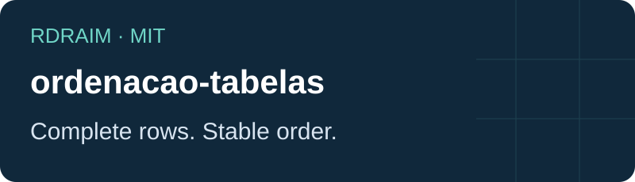
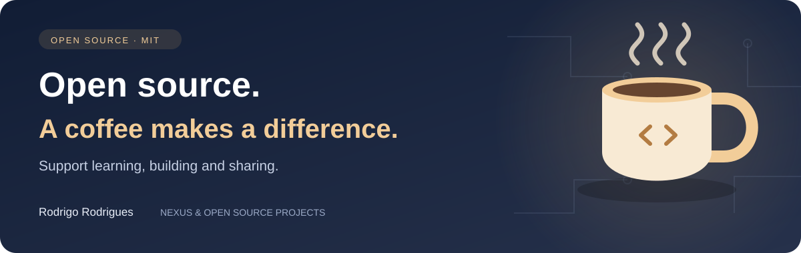

<p align="right">
  <a href="README.md"></a>
  <a href="README.en-US.md"></a>
  <a href="README.es-AR.md"></a>
</p>

# ordenacao-tabelas

<!-- public-badges:start -->
[](LICENSE) [](https://github.com/Rdraim/ordenacao-tabelas/actions) [](https://github.com/Rdraim/ordenacao-tabelas/releases) [](https://github.com/Rdraim/ordenacao-tabelas/commits/main)
<!-- public-badges:end -->

<p align="center"></p>

Stable record sorting, empty values last and explicit types.

Sorts complete rows without mutating the input. Text uses natural order for embedded digits; numbers and bigint require explicit types. Ties keep their original order and empty values stay last in either direction. The selector runs once per record.

Node.js 22 or later. Dependency-free ESM core, usable in modern browsers. Not published on npm: clone the repository or use a pinned Git revision. Preserve the license when copying the module.

## Usage

```bash
git clone https://github.com/Rdraim/ordenacao-tabelas.git
cd ordenacao-tabelas
npm test
npm run example
npm run example:integration
```

```js
import { ordenarRegistros } from './src/index.js';
const rows = [{ nome: 'Item 10' }, { nome: 'Item 2' }];
ordenarRegistros(rows, { valor: row => row.nome }); // Item 2, Item 10
```

## Contract

```text
ordenarRegistros(rows, { valor, tipo, direcao, idioma }) → new array
valor: row => value
tipo: 'texto' | 'numero' | 'inteiro' (bigint)
direcao: 'asc' | 'desc'
idioma: Intl locale; default 'pt-BR'
```

## Limits

Empty means null, undefined or an empty string. Does not coerce currency, dates, IPs or identifiers into numbers. Normalize explicitly before sorting. No React, stored preferences or DOM manipulation. O(n log n) complexity; collation depends on runtime Intl data.

## Verification

CI on Node 22 and 24, runnable examples, edge case tests and heuristic content/history checks. Automated checks do not replace human review.

## Contributing

Open an Issue with expected behavior and a synthetic example. Contributions need a PR with a regression test and synchronized documentation in all three languages. Do not submit real data, logs, configuration or credentials.

## Security

Use GitHub private vulnerability reporting when available. Do not post secrets or personal data in Issues. The core does not access networks, databases or files; validate contracts and limits in the consuming application.

## Changelog

1.0.0 — 2026-10-12: Initial release: independent contract, synthetic examples, tests and CI.

## License

[MIT](LICENSE) © Rodrigo Rodrigues

## Complete documentation

[API and recipes](API.en-US.md) · [Compatibility](COMPATIBILITY.en-US.md) · [Contributing](CONTRIBUTING.en-US.md) · [Security](SECURITY.en-US.md) · [Changelog](CHANGELOG.en-US.md) · [Voluntary support](SUPPORT.en-US.md)

## TypeScript contracts

The package includes .d.ts declarations; the core remains JavaScript ESM. Type examples in test-types/consumer.mts were checked with an existing compiler, without adding dependencies. CI runs runtime and content tests; it does not install a TypeScript compiler.

To repeat the check, use TypeScript installed in your environment:

```bash
tsc --noEmit --strict --target ES2022 --module NodeNext --moduleResolution NodeNext test-types/consumer.mts
```

## New release — 1.1.0

Adds generic types, documentation and a sparse-array regression: missing rows now fail explicitly.

Indicators are conditional: successful CI, a published stable release and stars/forks above zero. Refresh runs every six hours and on events; an open page needs reloading.

---

<p align="center">
  
</p>

## ☕ Buy me a coffee

Did this project help you solve a problem, learn something new, or take your first steps in development? If you feel like supporting my work, a coffee is a kind way to say thank you.

I’m **Rodrigo Rodrigues**, creator of **Nexus** and these open source projects. Your support helps me set aside time to improve the code, write clearer examples, and keep sharing what I learn.

**Give any amount that feels right to you. Supporting is completely optional — the project remains free under the MIT license.**

<p>
  <a href="#support-via-pix"></a>
  <a href="https://github.com/Rdraim/ordenacao-tabelas/issues/new?title=Feedback%3A%20this%20project%20helped%20me"></a>
</p>

### Support via Pix

In your banking app, scan the QR code or copy the Pix key below. Choose your amount and check the recipient details before confirming.

<p align="center">
  
</p>

**Pix key**

```text
8875a24e-44d1-4c91-b6bb-62c9f0070955
```

Pix is Brazil’s payment system. If your bank does not support it, you can still help by sharing the project, reporting a bug, improving the documentation, or leaving feedback.

### Your feedback matters, too

[Tell me how the project helped you](https://github.com/Rdraim/ordenacao-tabelas/issues/new?title=Feedback%3A%20this%20project%20helped%20me). I’d love to hear what you built, what you learned, and what could be clearer for someone just starting out.

A comment is welcome with or without a donation. Please keep payment receipts, personal details, credentials and private user data out of public Issues.

---

**Thank you for supporting my work and helping me keep building and sharing. ❤️**
