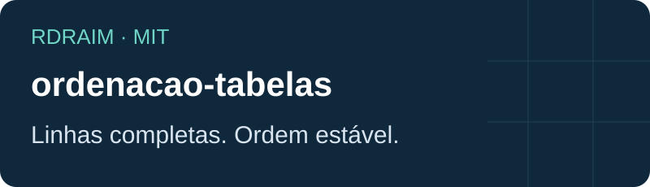

<p align="right">
  <a href="README.md"></a>
  <a href="README.en-US.md"></a>
  <a href="README.es-AR.md"></a>
</p>

# ordenacao-tabelas

<!-- public-badges:start -->
[](LICENSE) [](https://github.com/Rdraim/ordenacao-tabelas/actions) [](https://github.com/Rdraim/ordenacao-tabelas/releases) [](https://github.com/Rdraim/ordenacao-tabelas/commits/main)
<!-- public-badges:end -->

<p align="center"></p>

Ordenação estável de registros, vazios no fim e tipos explícitos.

Ordena linhas completas sem alterar a lista original. Texto usa ordem natural com números no nome; número e bigint exigem tipos próprios. Empates preservam a ordem inicial e vazios ficam no fim em ambos os sentidos. O seletor é chamado uma vez por registro.

Node.js 22 ou superior. Núcleo ESM sem dependências, utilizável em navegador moderno. Não publicado no npm: clone o repositório ou use uma revisão Git fixada. Preserve a licença ao copiar o módulo.

## Uso

```bash
git clone https://github.com/Rdraim/ordenacao-tabelas.git
cd ordenacao-tabelas
npm test
npm run example
npm run example:integration
```

```js
import { ordenarRegistros } from './src/index.js';
const rows = [{ nome: 'Item 10' }, { nome: 'Item 2' }];
ordenarRegistros(rows, { valor: row => row.nome }); // Item 2, Item 10
```

## Contrato

```text
ordenarRegistros(rows, { valor, tipo, direcao, idioma }) → new array
valor: row => value
tipo: 'texto' | 'numero' | 'inteiro' (bigint)
direcao: 'asc' | 'desc'
idioma: Intl locale; default 'pt-BR'
```

## Limites

Vazio significa null, undefined ou string vazia. Não converte moeda, data, IP ou identificadores para números. Normalize explicitamente antes de ordenar. Não tem React, preferências persistidas ou manipulação de DOM. Complexidade O(n log n); colação depende do Intl do runtime.

## Verificação

CI em Node 22 e 24, exemplos executáveis, testes de borda e revisão heurística de conteúdo/histórico. A revisão automática não substitui inspeção humana.

## Contribuição

Abra uma Issue com comportamento esperado e exemplo sintético. Para contribuir, envie PR com teste de regressão e documentação sincronizada nas três línguas. Não envie dados reais, logs, configurações ou credenciais.

## Segurança

Reporte vulnerabilidades pelo recurso privado de segurança do GitHub quando disponível. Não publique segredos nem dados pessoais em Issues. O núcleo não acessa rede, banco ou arquivos; valide contratos e limites no consumidor.

## Histórico

1.0.0 — 2026-10-12: Primeira versão: contrato independente, exemplos sintéticos, testes e CI.

## Licença

[MIT](LICENSE) © Rodrigo Rodrigues

## Documentação completa

[API e receitas](API.md) · [Compatibilidade](COMPATIBILITY.md) · [Contribuição](CONTRIBUTING.md) · [Segurança](SECURITY.md) · [Histórico](CHANGELOG.md) · [Apoio voluntário](SUPPORT.md)

## Contratos TypeScript

Declarações .d.ts acompanham o pacote; o núcleo continua JavaScript ESM. Exemplos de tipos em test-types/consumer.mts foram verificados com o compilador já disponível, sem acrescentar dependências. O CI executa testes de runtime e conteúdo; não instala um compilador TypeScript.

Para repetir a verificação, use o TypeScript instalado no seu ambiente:

```bash
tsc --noEmit --strict --target ES2022 --module NodeNext --moduleResolution NodeNext test-types/consumer.mts
```

## Nova versão — 1.1.0

Acrescenta tipos genéricos, documentação e regressão para arrays esparsos: linha ausente agora gera erro explícito.

Os indicadores são condicionais: CI apenas aprovado, release estável publicada e estrelas/forks acima de zero. Atualização agendada a cada seis horas e por eventos; uma página aberta precisa ser recarregada.

---

<p align="center">
  
</p>

## ☕ Me pague um café

Este projeto te ajudou a resolver um problema, aprender algo novo ou dar os primeiros passos no desenvolvimento? Se você sentir vontade de apoiar meu trabalho, um café é uma forma carinhosa de agradecer.

Sou **Rodrigo Rodrigues**, criador do **Nexus** e destes projetos de código aberto. Seu apoio me ajuda a dedicar tempo para melhorar o código, escrever exemplos mais claros e continuar compartilhando o que aprendo.

**Contribua com o valor que fizer sentido para você. O apoio é totalmente voluntário — o projeto continua gratuito sob a licença MIT.**

<p>
  <a href="#apoie-com-pix"></a>
  <a href="https://github.com/Rdraim/ordenacao-tabelas/issues/new?title=Coment%C3%A1rio%3A%20este%20projeto%20me%20ajudou"></a>
</p>

### Apoie com Pix

No aplicativo do seu banco, escaneie o QR Code ou copie a chave Pix abaixo. Escolha o valor e confira os dados do destinatário antes de confirmar.

<p align="center">
  
</p>

**Chave Pix**

```text
8875a24e-44d1-4c91-b6bb-62c9f0070955
```

Você também pode apoiar compartilhando o projeto, relatando um problema, melhorando a documentação ou deixando um comentário.

### Seu comentário também faz diferença

[Conte como o projeto te ajudou](https://github.com/Rdraim/ordenacao-tabelas/issues/new?title=Coment%C3%A1rio%3A%20este%20projeto%20me%20ajudou). Vou gostar de saber o que você criou, o que aprendeu e o que poderia ficar mais claro para quem está começando.

O comentário é bem-vindo com ou sem doação. Preserve sua privacidade: não publique comprovantes, dados pessoais, credenciais ou informações de usuários nas Issues.

---

**Obrigado por apoiar meu trabalho e me ajudar a continuar criando e compartilhando. ❤️**
